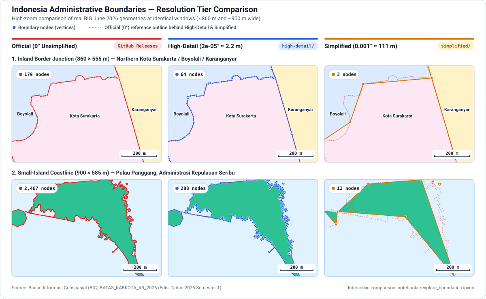

# Batas Wilayah Administrasi Indonesia

<p align="center"><a href="README.md">English 🇬🇧</a> | <strong>Bahasa Indonesia 🇮🇩</strong></p>

Dataset batas wilayah administrasi Indonesia dalam format GeoJSON dan GeoPackage yang rapi, siap pakai, dan dapat dibuat ulang secara konsisten (*reproducible*) — mulai dari tingkat nasional, provinsi, hingga kabupaten/kota. Seluruh data diolah dari rilis resmi **Badan Informasi Geospasial (BIG)** (**Juni 2026 / *Edisi Tahun 2026 Semester 1*** — mencakup `38` provinsi dan `514` kabupaten/kota).

---

## Tingkat Detail Data & Perbandingan Visual



Data batas wilayah disediakan dalam **tiga tingkat kedetailan (*tier*)** melalui **dua jalur distribusi di GitHub**. Pembagian ini dirancang agar visualisasi peta di web tetap ringan dan cepat dimuat, sementara alur kerja GIS yang membutuhkan tingkat kedetailan tinggi tetap mempertahankan data dengan presisi yang utuh:

| Tingkat Detail | Toleransi Simplifikasi | Lokasi Unduhan | Isi & Ukuran File | Cocok untuk |
| --- | --- | --- | --- | --- |
| **1. Official (Tanpa Simplifikasi)** | `0°` (~53,4 juta titik koordinat, topologi sudah dibersihkan) | [**GitHub Release `v2026.06`**](https://github.com/dmxsan/indonesia-admin-boundaries/releases/tag/v2026.06) | 7 paket arsip (`518 MiB – 1.5 GiB`) | Analisis di QGIS, PostGIS, DuckDB, perhitungan luas wilayah yang presisi, serta pemetaan garis pantai dan pulau-pulau kecil hingga skala sub-meter |
| **2. High-Detail (Detail Tinggi)** | `2e-05°` (~2,2 m, 6 angka desimal) | Git `main` → [`processed-data/high-detail/`](processed-data/high-detail) | 590 file GeoJSON (`<= 14.09 MB` per file) | Peta tingkat provinsi atau kabupaten/kota, pemanggilan langsung lewat URL (*direct fetch*), dan *overlay* di atas citra satelit |
| **3. Simplified (Ringan / Nasional)** | `0.001°` (~111 m, 6 angka desimal) | Git `main` → [`processed-data/simplified/`](processed-data/simplified) | 3 file gabungan se-Indonesia (`6.3 MB` / `7.4 MB` / `13 MB`) | Peta *choropleth* skala nasional dan aplikasi web interaktif yang menampilkan seluruh provinsi atau kabupaten/kota sekaligus |

> Seluruh poligon pada `simplified/` dan `high-detail/` disederhanakan secara serentak dengan menjaga keterhubungan batas antarwilayah (*topological coverage*) menggunakan `shapely.coverage_clean`, `coverage_simplify`, dan `coverage_union_all`. Hasilnya, garis batas yang bersebelahan tetap menyatu sempurna **tanpa tumpang-tindih (*zero overlap*)** maupun **celah sempit antarpoligon (*sliver gaps*)**.

---

## Struktur Repositori

```text
processed-data/
├── simplified/                            # 0.001° (~111 m) — digabung untuk seluruh Indonesia
│   ├── 01-national/indonesia.geojson
│   ├── 02-provinces/indonesia_provinces.geojson
│   └── 03-districts/indonesia_districts.geojson
└── high-detail/                           # 2e-05° (~2,2 m) — dipecah per wilayah
    ├── 02-provinces/
    │   ├── province-only/                 # 38 file (1 file batas provinsi)
    │   └── with-districts/                # 38 file (daftar kabupaten/kota di tiap provinsi)
    └── 03-districts/                      # 514 file (1 file per kabupaten/kota)
metadata/source.json                       # Informasi sumber data & hasil validasi topologi
metadata/catalog.json                      # Indeks JSON seluruh 38 provinsi & 514 kabupaten/kota
notebooks/explore_boundaries.ipynb         # Notebook interaktif untuk membandingkan ke-3 tingkat detail
scripts/
├── ingest.py                              # Script untuk mengunduh, membersihkan & memproses seluruh data
└── validate.py                            # Script pengujian geometri, topologi & kelengkapan atribut
CITATION.cff                               # Metadata sitasi repositori & sumber resmi BIG
```

---

## Cara Pakai Cepat (Akses Langsung dari Git `main`)

Semua file di dalam folder `processed-data/` dapat langsung dipanggil melalui `raw.githubusercontent.com` tanpa perlu meng-*clone* repositori ini terlebih dahulu:

> **Tips (Mengunci versi data):** Ganti `/main/` menjadi `/v2026.06/` pada URL `raw.githubusercontent.com` di bawah jika Anda ingin mengunci aplikasi pada rilis edisi Juni 2026 agar struktur datanya tidak berubah ketika ada pembaruan di masa mendatang.

### Python (`geopandas`)

```python
import geopandas as gpd

BASE = "https://raw.githubusercontent.com/dmxsan/indonesia-admin-boundaries/main/processed-data"

# Peta nasional yang ringan untuk dimuat cepat (0.001° simplified)
provinces = gpd.read_file(f"{BASE}/simplified/02-provinces/indonesia_provinces.geojson")

# Batas kabupaten/kota dalam satu provinsi dengan detail tinggi (2e-05° high-detail)
jateng_districts = gpd.read_file(f"{BASE}/high-detail/02-provinces/with-districts/Jawa_Tengah.geojson")
```

### JavaScript (`fetch`)

```javascript
const BASE = "https://raw.githubusercontent.com/dmxsan/indonesia-admin-boundaries/main/processed-data";

// Seluruh 514 kabupaten/kota untuk peta choropleth nasional (~13 MB)
const districtsRes = await fetch(`${BASE}/simplified/03-districts/indonesia_districts.geojson`);
const indonesiaDistricts = await districtsRes.json();

// Satu wilayah kabupaten/kota dengan detail tinggi
const soloRes = await fetch(`${BASE}/high-detail/03-districts/Kota_Surakarta.geojson`);
const soloGeoJSON = await soloRes.json();
```

Jika ingin melihat dan membandingkan perbedaan tingkat kedetailan garis batas secara interaktif di Jupyter, silakan buka [notebooks/explore_boundaries.ipynb](notebooks/explore_boundaries.ipynb). Untuk mencari kode Kemendagri/BPS, *bounding box*, maupun lokasi file ke-`38` provinsi dan `514` kabupaten/kota secara terprogram, silakan gunakan indeks JSON di [`metadata/catalog.json`](metadata/catalog.json).

### Alur Kerja GIS & Cloud (QGIS, GEE & DuckDB)

- **QGIS Desktop (Tanpa Unduh Manual):** Muat file GeoJSON dari `raw.githubusercontent.com/.../v2026.06/processed-data/.../*.geojson` langsung melalui menu *Layer → Data Source Manager → Vector → Protocol: HTTP(S), cloud, etc.*. Untuk membuka satu wilayah versi resmi tanpa simplifikasi (`0°`) dari aset GitHub Release `v2026.06` tanpa harus mengunduh seluruh arsip `.zip`, pilih *Source Type: File* (agar QGIS tidak menyisipkan awalan `/vsicurl/` ganda) lalu gunakan path berikut:
  ```text
  /vsizip//vsicurl/https://github.com/dmxsan/indonesia-admin-boundaries/releases/download/v2026.06/official_03-districts_split-by-district.zip/03-districts/Kota_Surakarta.geojson
  ```
- **Google Earth Engine (Python API):** Untuk file GeoJSON *High-Detail* tingkat kabupaten/kota maupun provinsi berukuran `≲ 8 MB` (agar tetap aman di bawah batas payload `10 MiB` GEE setelah serialisasi), muat langsung ke `ee.FeatureCollection(requests.get(url).json())` di memori tanpa perlu mengunggah *Table asset* terlebih dahulu:
  ```python
  import ee, requests

  ee.Initialize(project="your-gcp-project")
  url = "https://raw.githubusercontent.com/dmxsan/indonesia-admin-boundaries/v2026.06/processed-data/high-detail/02-provinces/with-districts/Jawa_Tengah.geojson"
  roi = ee.FeatureCollection(requests.get(url).json())
  ```
- **DuckDB Spatial:** Jalankan query spasial langsung melalui HTTPS tanpa mengunduh file ke disk:
  ```sql
  INSTALL httpfs;
  LOAD httpfs;
  INSTALL spatial;
  LOAD spatial;

  SELECT WADMPR, WADMKK
  FROM ST_Read('https://raw.githubusercontent.com/dmxsan/indonesia-admin-boundaries/v2026.06/processed-data/high-detail/02-provinces/with-districts/Jawa_Tengah.geojson');
  ```

---

## Data Resmi Tanpa Simplifikasi (`v2026.06`)

Karena ukuran file GeoJSON versi asli dari BIG untuk seluruh Indonesia melampaui batas ukuran file Git di GitHub (`100 MB`), data batas wilayah edisi Juni 2026 yang **100% utuh (tanpa penyederhanaan titik koordinat)** disediakan melalui halaman [**GitHub Release `v2026.06`**](https://github.com/dmxsan/indonesia-admin-boundaries/releases/tag/v2026.06) (masing-masing arsip berukuran di bawah `2 GiB`).

### 1. Paket Lengkap GeoPackage *(Disarankan untuk QGIS, Python, DuckDB & PostGIS)*

| Nama File | Keterangan | Ukuran |
| --- | --- | --- |
| `official_all-levels_indonesia.gpkg.zip` | Satu file GeoPackage yang memuat ke-3 *layer* sekaligus (`country`, `provinces`, `districts`) lengkap dengan *spatial index* SQLite | `~1.5 GiB` |

### 2. GeoJSON Gabungan Nasional *(1 file berisi seluruh wilayah se-Indonesia)*

| Nama File | Keterangan | Ukuran |
| --- | --- | --- |
| `official_01-national_indonesia_merged.geojson.gz` | Batas luar wilayah nasional Indonesia (`1` fitur) | `~518 MiB` |
| `official_02-provinces_merged.geojson.gz` | Seluruh `38` provinsi dalam satu file GeoJSON | `~527 MiB` |
| `official_03-districts_merged.geojson.gz` | Seluruh `514` kabupaten/kota dalam satu file GeoJSON | `~567 MiB` |

### 3. GeoJSON Terpisah per Wilayah *(file `.geojson` tersendiri untuk tiap provinsi / kabupaten-kota di dalam `.zip`)*

| Nama File | Keterangan | Ukuran |
| --- | --- | --- |
| `official_02-provinces_split-by-province.zip` | `38` file terpisah (`02-provinces/province-only/<Province>.geojson`) | `~527 MiB` |
| `official_02-provinces_split-with-districts.zip` | `38` file terpisah (`02-provinces/with-districts/<Province>.geojson`) | `~567 MiB` |
| `official_03-districts_split-by-district.zip` | `514` file terpisah (`03-districts/<District>.geojson`) | `~567 MiB` |

### Memverifikasi & Membaca File Rilis

Anda dapat memastikan keutuhan file hasil unduhan menggunakan `SHA256SUMS.txt` (tersedia di halaman rilis). Di Python, Anda juga bisa langsung membaca satu wilayah tertentu dari dalam file `.zip` tanpa perlu mengekstrak seluruh isinya:

```bash
# Verifikasi checksum file rilis yang sudah diunduh
sha256sum -c SHA256SUMS.txt
```

```python
import geopandas as gpd

# Membaca satu kabupaten/kota versi utuh (0°) langsung dari dalam arsip zip
seribu = gpd.read_file(
    "zip://official_03-districts_split-by-district.zip!03-districts/Administrasi_Kepulauan_Seribu.geojson"
)

# Atau mengambil data pada area tertentu saja (bounding box) dari GeoPackage
bbox_df = gpd.read_file(
    "zip://official_all-levels_indonesia.gpkg.zip",
    layer="districts",
    bbox=(106.56, -5.78, 106.64, -5.72),
)
```

---

## Skema Atribut & Catatan Data

### Daftar Atribut (*Properties*)

| Nama Atribut | Cakupan Layer | Keterangan |
| --- | --- | --- |
| `WADMPR` | Provinsi & Kabupaten/Kota | Nama resmi provinsi |
| `WADMKK` | Kabupaten/Kota | Nama resmi kabupaten/kota |
| `KDPPUM` | Provinsi & Kabupaten/Kota | Kode wilayah provinsi Kemendagri (PUM) |
| `KDPKAB` | Kabupaten/Kota | Kode wilayah kabupaten/kota Kemendagri (PUM) |
| `KDPBPS` | Provinsi & Kabupaten/Kota | Kode wilayah provinsi BPS *(bisa bernilai `null` pada data sumber BIG 2026)* |
| `KDBBPS` | Kabupaten/Kota | Kode wilayah kabupaten/kota BPS *(bisa bernilai `null` pada data sumber BIG 2026)* |
| `name`, `iso_a2`, `iso_a3` | Nasional (`indonesia.geojson`) | `Indonesia`, `ID`, `IDN` |

### Catatan Dataset (`v2026.06` dibanding Versi `v2023.09`)

- **Jumlah wilayah sesuai data resmi 2026:** Tercatat tepat **`38` provinsi** dan **`514` kabupaten/kota**. Sebanyak `21` poligon perairan/batas laut pada data mentah BIG yang tidak memiliki nama kabupaten/kota (`WADMKK` bernilai `null`) telah disaring keluar dan didokumentasikan di [`metadata/source.json`](metadata/source.json).
- **Penyesuaian penamaan resmi BIG 2026:** Mengikuti penulisan nomenklatur terbaru dari BIG (seperti `Daerah_Khusus_Ibukota_Jakarta`, `Administrasi_Kepulauan_Seribu`, `Kota_Administrasi_Jakarta_*`, `Kota_Padangsidimpuan`, `Kota_Tanjungbalai`, `Mukomuko`, `Toli-Toli`), sekaligus membersihkan anomali dari rilis lama seperti file `None.geojson` atau nama wilayah yang tergabung. Data versi lama tahun 2023 tetap dapat diakses melalui tag Git `v2023.09`.
- **Penanganan nama kabupaten/kota yang kembar:** Apabila terdapat dua provinsi yang memiliki nama kabupaten/kota yang sama, nama file di dalam `high-detail/03-districts/` akan otomatis ditambahkan nama provinsinya dengan format `<WADMKK>__<WADMPR>.geojson` agar tidak saling menimpa.
- **Mengikuti standar GeoJSON RFC 7946:** Menggunakan sistem koordinat 2D WGS84 (`EPSG:4326`), urutan titik poligon luar berlawanan arah jarum jam (*counter-clockwise*), geometri yang valid, serta hasil pemeriksaan topologi yang tercatat lengkap di [`metadata/source.json`](metadata/source.json).

---

## Menjalankan Proses Pengolahan Data Secara Lokal

```bash
python3 -m venv .venv
source .venv/bin/activate
pip install -r requirements.txt

# 1. Unduh data mentah BIG beserta metadata XML ke folder raw-data/, lalu bentuk processed-data/ & dist/
python scripts/ingest.py --download

# (Opsional: tambahkan --skip-dist bila hanya ingin membuat processed-data/ tanpa mengemas arsip rilis dist/)
python scripts/ingest.py --download --skip-dist

# 2. Jalankan pemeriksaan geometri, topologi, dan kelengkapan ke-593 file GeoJSON
python scripts/validate.py
```

---

## Sumber Data, Atribusi & Lisensi

- **Sumber Resmi:** Badan Informasi Geospasial (BIG) — [Ina-Geoportal](https://tanahair.indonesia.go.id/) & [Geoportal BIG](https://geoportal.big.go.id/)
- **Dataset Acuan:** `BATAS_KABKOTA_AR_2026` (*Edisi Tahun 2026 Semester 1*, pembaruan `2026-06-12`, ID metadata `TASWIL5000020260612KABKOTA`)
- **Ketentuan Lisensi (*Dual License*):** Detail lengkap tersedia pada file [`LICENSE`](LICENSE) — seluruh kode pemrosesan di dalam folder `scripts/` berada di bawah lisensi **MIT**, sedangkan data geospasial batas wilayah tetap merupakan hak cipta **© Badan Informasi Geospasial (BIG)** untuk keperluan non-komersial, pendidikan, riset, dan pengembangan aplikasi dengan tetap mencantumkan BIG sebagai sumber data.
- **Sitasi:** Metadata sitasi terstruktur untuk repositori ini beserta dataset acuan BIG tersedia pada [`CITATION.cff`](CITATION.cff).

> *"Data batas yang berstatus indikatif tidak dapat dijadikan referensi hukum."*
