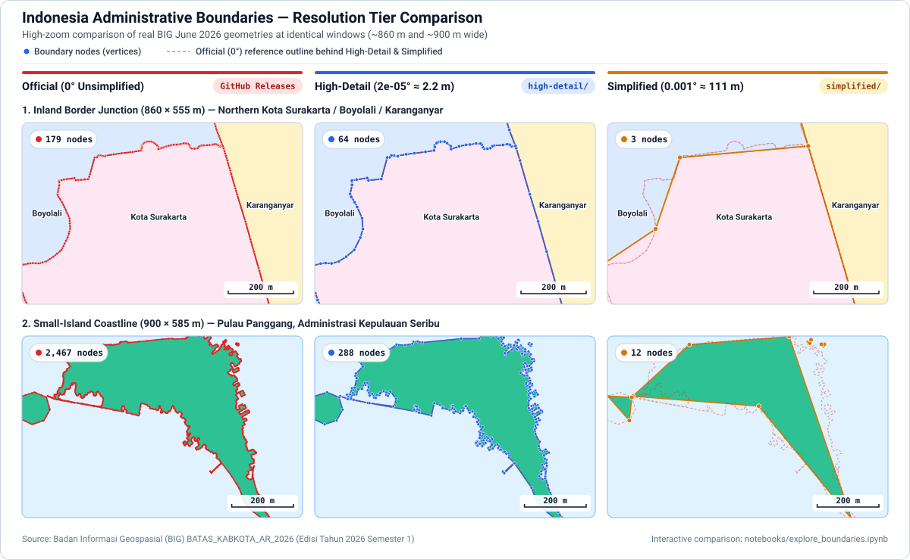

# Indonesia Administrative Boundaries

Clean, reproducible GeoJSON and GeoPackage boundaries of Indonesia from national down to kabupaten/kota level, derived from official **Badan Informasi Geospasial (BIG)** data (**June 2026 / *Edisi Tahun 2026 Semester 1*** — `38` provinces, `514` districts).

---

## Resolution Tiers & Visual Comparison



Boundaries are distributed across **three resolution tiers** and **two GitHub channels** so web maps stay fast and lightweight while full-resolution GIS workflows retain complete precision:

| Tier | Simplification | Distribution | Contents & Sizes | Best for |
| --- | --- | --- | --- | --- |
| **1. Official Unsimplified** | `0°` (~53.4M vertices, cleaned coverage) | [**GitHub Release `v2026.06`**](https://github.com/dmxsan/indonesia-admin-boundaries/releases/tag/v2026.06) | 7 release packs (`518 MiB – 1.5 GiB`) | QGIS, PostGIS, DuckDB, exact area calculations, sub-meter small-island coastlines |
| **2. High-Detail** | `2e-05°` (~2.2 m, 6 decimal places) | Git `main` → [`processed-data/high-detail/`](processed-data/high-detail) | 590 GeoJSON files (`<= 14.09 MB` each) | Regional / district maps, direct URL fetch, zoomed-in satellite overlays |
| **3. Simplified** | `0.001°` (~111 m, 6 decimal places) | Git `main` → [`processed-data/simplified/`](processed-data/simplified) | 3 nationwide files (`6.3 MB` / `7.4 MB` / `13 MB`) | Fast nationwide choropleths & browser maps showing all provinces or districts at once |

> All `simplified/` and `high-detail/` polygons are processed together with `shapely.coverage_clean`, `coverage_simplify`, and `coverage_union_all` — guaranteeing **zero overlapping shared borders** and **zero artificial interior sliver gaps**.

---

## Repository Structure

```text
processed-data/
├── simplified/                            # 0.001° (~111 m) — nationwide merged
│   ├── 01-national/indonesia.geojson
│   ├── 02-provinces/indonesia_provinces.geojson
│   └── 03-districts/indonesia_districts.geojson
└── high-detail/                           # 2e-05° (~2.2 m) — split by region
    ├── 02-provinces/
    │   ├── province-only/                 # 38 files (1 per province)
    │   └── with-districts/                # 38 files (districts per province)
    └── 03-districts/                      # 514 files (1 per kabupaten/kota)
metadata/source.json                       # Source provenance & topology checks
notebooks/explore_boundaries.ipynb         # Interactive 3-tier comparison map
scripts/
├── ingest.py                              # Download, clean & build all tiers
└── validate.py                            # Geometry, topology & metadata checks
```

---

## Quick Usage (Direct Fetch from Git `main`)

Fetch any file in `processed-data/` directly via `raw.githubusercontent.com` without cloning the repository:

### Python (`geopandas`)

```python
import geopandas as gpd

BASE = "https://raw.githubusercontent.com/dmxsan/indonesia-admin-boundaries/main/processed-data"

# Fast nationwide map (0.001° simplified)
provinces = gpd.read_file(f"{BASE}/simplified/02-provinces/indonesia_provinces.geojson")

# Zoomed regional districts (2e-05° high-detail)
jateng_districts = gpd.read_file(f"{BASE}/high-detail/02-provinces/with-districts/Jawa_Tengah.geojson")
```

### JavaScript (`fetch`)

```javascript
const BASE = "https://raw.githubusercontent.com/dmxsan/indonesia-admin-boundaries/main/processed-data";

// All 514 districts for nationwide choropleth (~13 MB)
const districtsRes = await fetch(`${BASE}/simplified/03-districts/indonesia_districts.geojson`);
const indonesiaDistricts = await districtsRes.json();

// Single high-detail kabupaten/kota
const soloRes = await fetch(`${BASE}/high-detail/03-districts/Kota_Surakarta.geojson`);
const soloGeoJSON = await soloRes.json();
```

To inspect and compare tiers interactively in Jupyter, open [notebooks/explore_boundaries.ipynb](notebooks/explore_boundaries.ipynb).

---

## Official Unsimplified Releases (`v2026.06`)

Because BIG's full-resolution nationwide GeoJSONs exceed GitHub's `100 MB` Git file limit, **100% unsimplified** BIG June 2026 boundaries are published as release assets on [**GitHub Release `v2026.06`**](https://github.com/dmxsan/indonesia-admin-boundaries/releases/tag/v2026.06) (all strictly `< 2 GiB` per file).

### 1. All-in-One GeoPackage *(Recommended for QGIS, Python, DuckDB & PostGIS)*

| Asset | Contents | Size |
| --- | --- | --- |
| `official_all-levels_indonesia.gpkg.zip` | Single GeoPackage with all 3 merged layers (`country`, `provinces`, `districts`) and SQLite spatial index | `~1.5 GiB` |

### 2. Merged Nationwide GeoJSONs *(1 single file containing all features across Indonesia)*

| Asset | Contents | Size |
| --- | --- | --- |
| `official_01-national_indonesia_merged.geojson.gz` | Indonesia national outline (`1` feature) | `~518 MiB` |
| `official_02-provinces_merged.geojson.gz` | All `38` provinces merged into one GeoJSON | `~527 MiB` |
| `official_03-districts_merged.geojson.gz` | All `514` districts merged into one GeoJSON | `~567 MiB` |

### 3. Split Per-Region GeoJSONs *(individual per-province / per-district `.geojson` files inside `.zip`)*

| Asset | Contents | Size |
| --- | --- | --- |
| `official_02-provinces_split-by-province.zip` | `38` individual files (`02-provinces/province-only/<Province>.geojson`) | `~527 MiB` |
| `official_02-provinces_split-with-districts.zip` | `38` individual files (`02-provinces/with-districts/<Province>.geojson`) | `~567 MiB` |
| `official_03-districts_split-by-district.zip` | `514` individual files (`03-districts/<District>.geojson`) | `~567 MiB` |

### Reading & Verifying Release Assets

You can verify downloaded archives against `SHA256SUMS.txt` (attached to the release) and read individual regions from the split archives in Python without unpacking the entire zip:

```bash
# Verify downloaded release files
sha256sum -c SHA256SUMS.txt
```

```python
import geopandas as gpd

# Read one official unsimplified district straight from the split zip
seribu = gpd.read_file(
    "zip://official_03-districts_split-by-district.zip!03-districts/Administrasi_Kepulauan_Seribu.geojson"
)

# Or query by bounding box from the GeoPackage
bbox_df = gpd.read_file(
    "zip://official_all-levels_indonesia.gpkg.zip",
    layer="districts",
    bbox=(106.56, -5.78, 106.64, -5.72),
)
```

---

## Attribute Schema & Data Notes

### Properties Included

| Property | Level | Description |
| --- | --- | --- |
| `WADMPR` | Province & District | Official province name |
| `WADMKK` | District | Official kabupaten/kota name |
| `KDPPUM` | Province & District | Ministry of Home Affairs (Kemendagri / PUM) province code |
| `KDPKAB` | District | Kemendagri / PUM kabupaten/kota code |
| `KDPBPS` | Province & District | BPS province code *(nullable in BIG 2026 source)* |
| `KDBBPS` | District | BPS kabupaten/kota code *(nullable in BIG 2026 source)* |
| `name`, `iso_a2`, `iso_a3` | Country (`indonesia.geojson`) | `Indonesia`, `ID`, `IDN` |

### Dataset Notes (`v2026.06` vs. `v2023.09` Baseline)

- **Exact 2026 counts:** **`38` provinces** and **`514` kabupaten/kota**. `21` non-district water/maritime polygons with null `WADMKK` in the raw BIG layer are excluded and logged in [`metadata/source.json`](metadata/source.json).
- **2026 official naming updates from BIG:** Reflects current official names (e.g., `Daerah_Khusus_Ibukota_Jakarta`, `Administrasi_Kepulauan_Seribu`, `Kota_Administrasi_Jakarta_*`, `Kota_Padangsidimpuan`, `Kota_Tanjungbalai`, `Mukomuko`, `Toli-Toli`), and eliminates earlier `None.geojson` / merged-name artifacts. The untouched 2023 dataset remains preserved under Git tag `v2023.09`.
- **Duplicate district names:** If two provinces share a district name, files in `high-detail/03-districts/` are automatically disambiguated as `<WADMKK>__<WADMPR>.geojson`.
- **RFC 7946 compliant:** 2D WGS84 (`EPSG:4326`) coordinates, counter-clockwise exterior rings, valid geometries, and coverage validation recorded in [`metadata/source.json`](metadata/source.json).

---

## Reproducing Locally

```bash
python3 -m venv .venv
source .venv/bin/activate
pip install -r requirements.txt

# 1. Download BIG archive + ISO metadata XML into raw-data/ and build processed-data/ + dist/
python scripts/ingest.py --download

# (Optional: skip building dist/ release archives if you only need processed-data/)
python scripts/ingest.py --download --skip-dist

# 2. Validate all 593 GeoJSON files, topological coverage, and metadata parity
python scripts/validate.py
```

---

## Data Source, Attribution & License

- **Provider:** Badan Informasi Geospasial (BIG) — [Ina-Geoportal](https://tanahair.indonesia.go.id/) & [Geoportal BIG](https://geoportal.big.go.id/)
- **Source Dataset:** `BATAS_KABKOTA_AR_2026` (*Edisi Tahun 2026 Semester 1*, revised `2026-06-12`, metadata ID `TASWIL5000020260612KABKOTA`)
- **Dual License:** See [`LICENSE`](LICENSE) — scripts in `scripts/` are **MIT-licensed**; geospatial data remains **© Badan Informasi Geospasial (BIG)** and is provided for non-commercial, educational, research, and software development use with mandatory attribution to BIG.

> *"Data batas yang berstatus indikatif tidak dapat dijadikan referensi hukum."*  
> (Indicative boundary data cannot be used as a legal reference.)
